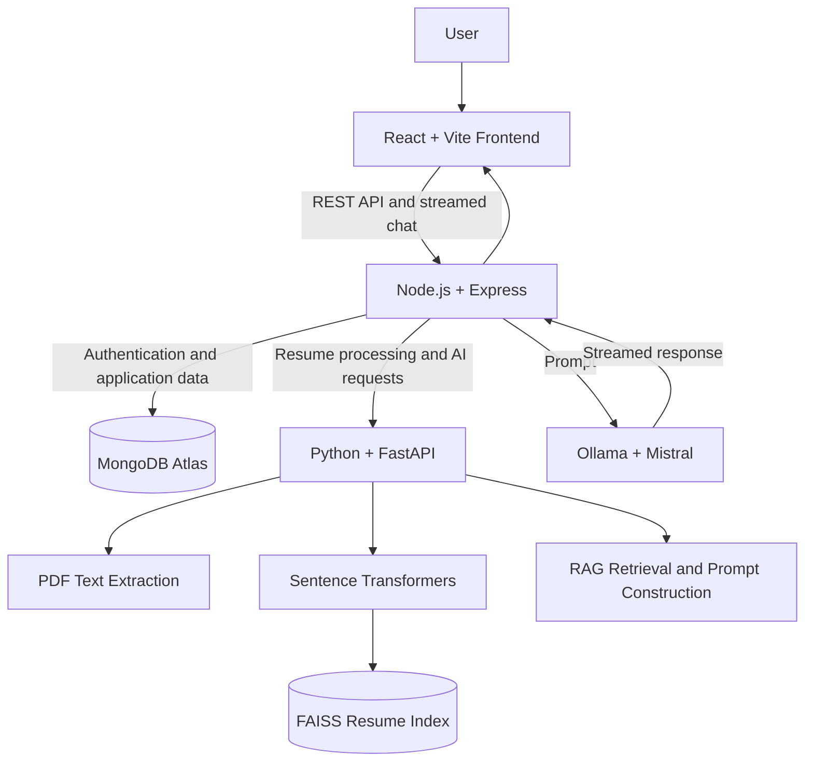

# AI-Powered Job Tracker

A full-stack job application tracker with AI-assisted resume analysis, semantic search, and a conversational career assistant powered by retrieval-augmented generation (RAG).

## Overview

AI-Powered Job Tracker helps users organize job applications and explore their resumes through an AI assistant. It combines a MERN-style web application with a separate Python AI service for resume processing, embeddings, semantic retrieval, and RAG prompt construction.

The project demonstrates full-stack development, authentication, REST APIs, vector search, LLM integration, streaming responses, and conversation persistence.

## Features

- **Job application management** — Create, update, and track job applications.
- **Authentication** — JWT-based authentication and protected application routes.
- **Resume management** — Upload and process PDF resumes.
- **AI resume analysis** — Generate resume analysis using the AI service.
- **Semantic retrieval** — Split resume text into chunks, generate embeddings, and retrieve relevant content using FAISS.
- **Conversational career assistant** — Ask questions about your resume using retrieved context.
- **Streaming responses** — Display AI responses incrementally.
- **Conversation persistence** — Save conversations and load previous messages.
- **Agent routing foundation** — Route requests to general chat, resume search, or job matching.

> **Current limitation:** Job matching is not fully implemented. The job-matching route currently communicates that the feature is under development.

## Technology Stack

| Component      | Technologies                              |
| -------------- | ----------------------------------------- |
| Frontend       | React, Vite, JavaScript                   |
| Backend        | Node.js, Express.js                       |
| Database       | MongoDB Atlas, Mongoose                   |
| Authentication | JSON Web Tokens (JWT)                     |
| AI service     | Python, FastAPI                           |
| Embeddings     | Sentence Transformers, `all-MiniLM-L6-v2` |
| Vector search  | FAISS                                     |
| Language model | Ollama with Mistral                       |
| Communication  | REST APIs, streamed HTTP responses        |

## Architecture

The application separates the web interface, backend orchestration, database, and AI processing.



### Request flow

1. The React frontend sends requests to the Express backend.
2. The backend handles authentication, application logic, and database operations.
3. The Python service extracts resume text and generates embeddings.
4. FAISS retrieves relevant resume chunks for semantic search.
5. The Python service constructs a context-aware prompt.
6. The backend sends the prompt to Ollama and streams the response to the frontend.
7. Conversations are persisted in MongoDB.

### Data storage

- **MongoDB Atlas:** Users, jobs, resumes, resume analysis, and conversations.
- **FAISS:** Local vector indexes used for semantic retrieval.
- **Local filesystem:** Uploaded resume files and AI index artifacts.

## Project Structure

```text
Job Tracker Application/
├── ai-service/
│   ├── services/
│   ├── utils/
│   ├── app.py
│   └── requirements.txt
├── backend/
│   ├── config/
│   ├── controllers/
│   ├── db/
│   ├── middlewares/
│   ├── models/
│   ├── routes/
│   ├── services/
│   ├── utils/
│   ├── index.js
│   └── package.json
├── frontend/
│   ├── src/
│   ├── public/
│   └── package.json
├── .gitignore
└── README.md
```

## Getting Started

### Prerequisites

Install or configure:

- Node.js and npm
- Python and pip
- MongoDB Atlas or a compatible MongoDB deployment
- Ollama
- The Mistral model in Ollama

### 1. Clone the repository

```bash
git clone https://github.com/AyushSar1/AI-powered-job-tracker.git
cd "Job Tracker Application"
```

### 2. Configure the backend

Create `backend/.env` using the variables documented in `backend/.env.example`.

Populate the required values locally. Never commit actual credentials or secrets.

Install dependencies:

```bash
cd backend
npm install
```

### 3. Configure the AI service

Create and activate a Python virtual environment inside `ai-service`, then install dependencies:

```bash
cd ai-service
python -m venv venv
```

Windows PowerShell:

```powershell
.\venv\Scripts\Activate.ps1
```

Install the Python requirements:

```bash
pip install -r requirements.txt
```

Start the service using the entry point configured by the application:

```bash
uvicorn app:app --reload
```

### 4. Configure Ollama

Install Ollama and download the model:

```bash
ollama pull mistral
```

Start Ollama and ensure the backend is configured to reach its API.

### 5. Start the backend

In a separate terminal:

```bash
cd backend
npm run dev
```

If your `package.json` uses a different development or start script, use the script defined there.

### 6. Start the frontend

In another terminal:

```bash
cd frontend
npm install
npm run dev
```

Open the local URL displayed by Vite.

> **Configuration note:** Verify the environment variable names, backend scripts, service URLs, and ports against the actual source code before using these instructions for a fresh installation.

## AI Design

### Embeddings and semantic search

Resume text is split into overlapping chunks. The `all-MiniLM-L6-v2` model converts text into 384-dimensional embeddings. FAISS indexes the chunk vectors and retrieves relevant content using normalized vector similarity.

### Retrieval-Augmented Generation (RAG)

Instead of sending the entire resume for every question, the AI service retrieves relevant resume sections and uses them to construct a context-aware prompt. Ollama/Mistral generates the answer.

### Streaming and conversation history

The backend streams model output to the frontend. Conversations are stored separately from resume records, allowing message history to persist independently of resume replacement or deletion.

### Agent routing

A routing layer classifies requests into general chat, resume search, or job matching. Application code controls the execution of supported tools rather than giving the language model unrestricted database access.

## Security and Privacy

- Keep environment files and credentials out of version control.
- Keep uploaded resumes and generated vector indexes out of the public repository.
- Configure MongoDB access controls and network permissions appropriately.
- Use authentication and authorization checks for protected API routes.
- Treat resume data and AI-generated output as potentially sensitive.

## Known Limitations

- Job matching is currently under development.
- AI processing requires the Python service and local Ollama/Mistral runtime.
- FAISS indexes are stored locally and require an indexing workflow to be recreated when necessary.
- Semantic similarity is an experimental relevance signal, not a definitive measure of job suitability.
- The current setup is designed as a portfolio project rather than a production-scale deployment.

## Future Improvements

- Complete job matching and improve its evaluation.
- Deploy the frontend, backend, and AI service.
- Add automated tests and continuous integration.
- Improve error handling, observability, and AI response evaluation.
- Explore more robust index persistence and scalable retrieval infrastructure.

## License

This project is available under the license specified in the repository's `LICENSE` file, once added.
