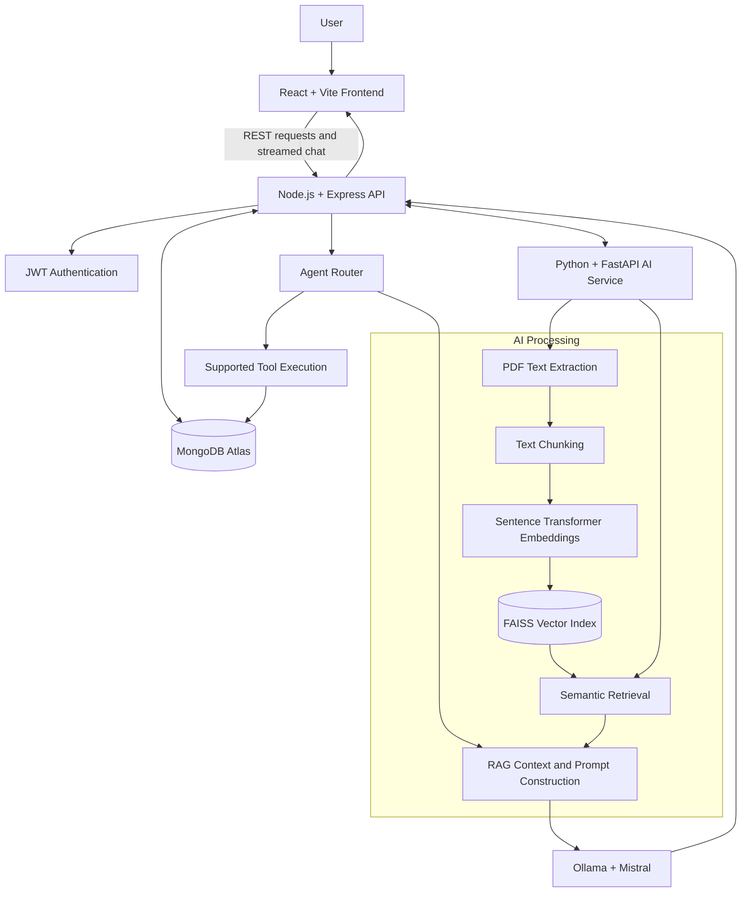
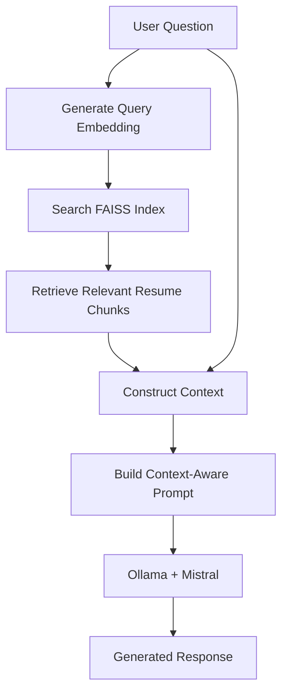
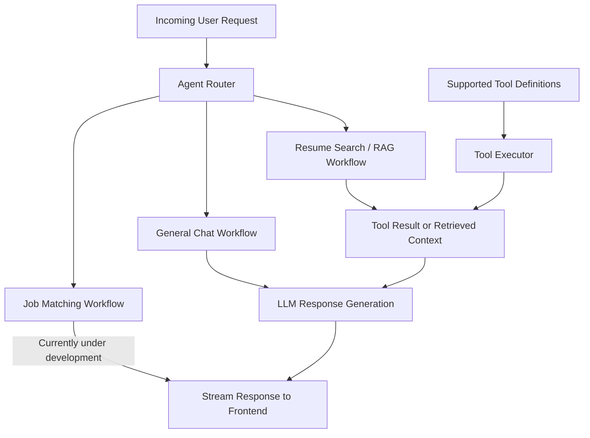
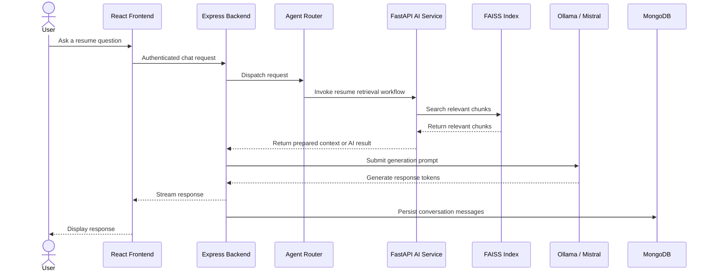

# AI-Powered Job Tracker

A full-stack job application tracker with AI-assisted resume analysis, semantic retrieval, and a conversational career assistant powered by Retrieval-Augmented Generation (RAG), Sentence Transformers, FAISS, and Ollama/Mistral.

## Overview

AI-Powered Job Tracker helps users manage job applications and interact with their resumes through a conversational AI assistant.

The application combines a React frontend, an Express backend, MongoDB for persistent application data, and a separate Python AI service for resume processing, embedding generation, semantic retrieval, and RAG workflows.

Rather than relying exclusively on an LLM prompt, the AI pipeline can retrieve relevant resume content and incorporate it into the context supplied to the language model. A backend orchestration layer also provides request routing and controlled execution of supported application tools.

The project demonstrates full-stack engineering, API design, JWT authentication, vector search, embeddings, RAG, LLM integration, streamed responses, and conversation persistence.

## Features

- **Job application management** — Create, update, and track job applications.
- **JWT authentication** — Authenticate users and protect application routes.
- **Resume management** — Upload and process PDF resumes.
- **AI resume analysis** — Generate resume analysis through the AI service.
- **Semantic retrieval** — Split resume text into chunks, generate embeddings, and retrieve relevant content using FAISS.
- **Conversational career assistant** — Ask questions about resume content using retrieved context.
- **Streaming responses** — Display generated responses incrementally.
- **Conversation persistence** — Store conversations and retrieve previous messages.
- **Agent routing** — Route requests to supported workflows such as general chat, resume search, and job matching.
- **Separated AI architecture** — Keep resume processing and vector retrieval in a dedicated Python service.

> **Current limitation:** Job matching is under development. The job-matching route currently reports that the feature is not yet implemented.

## Technology Stack

| Component         | Technologies                              |
| ----------------- | ----------------------------------------- |
| Frontend          | React, Vite, JavaScript                   |
| Backend           | Node.js, Express.js                       |
| Database          | MongoDB Atlas, Mongoose                   |
| Authentication    | JSON Web Tokens (JWT)                     |
| AI service        | Python, FastAPI                           |
| Embeddings        | Sentence Transformers, `all-MiniLM-L6-v2` |
| Vector search     | FAISS                                     |
| Language model    | Ollama with Mistral                       |
| Resume processing | PDF text extraction and text chunking     |
| Communication     | REST APIs and streamed HTTP responses     |

## System Architecture

The application separates user interaction, API orchestration, persistent data, and AI processing.



### Main components

**1. React frontend**

Provides the user interface for authentication, job application management, resume workflows, and conversational AI. It communicates with the backend through HTTP requests and displays streamed responses.

**2. Express backend**

Acts as the application's API layer. It handles authentication, application workflows, database operations, AI orchestration, and communication between the frontend and AI-related services.

**3. MongoDB Atlas**

Stores persistent application data, including users, job records, resume-related records, resume analysis, and conversations.

**4. Python AI service**

Handles resume processing and AI workflows such as text extraction, chunking, embedding generation, vector retrieval, and RAG context preparation.

**5. FAISS vector index**

Stores or searches resume chunk vectors to retrieve semantically relevant content. The index is local to the configured AI service rather than a hosted vector database.

**6. Ollama and Mistral**

Provide local language-model inference for generating conversational responses from the prompts and context supplied by the application.

### Typical request flow

1. The user submits a request through the React frontend.
2. The Express backend authenticates the request and dispatches the relevant application workflow.
3. For resume-related questions, the AI service retrieves relevant resume content when an indexed resume is available.
4. The application constructs a prompt using the question and retrieved context.
5. Ollama/Mistral generates the response.
6. The backend streams the generated output to the frontend.
7. Conversation messages are persisted in MongoDB.

The precise execution order depends on the selected workflow. Resume ingestion, retrieval, and conversational generation are distinct stages.

## AI Pipeline

The AI component consists of multiple processing stages rather than only a prompt sent to a language model.

### 1. Resume ingestion and preprocessing

The resume ingestion workflow prepares uploaded PDF documents for retrieval.


The stages are:

1. **PDF extraction:** Extract textual content from an uploaded resume.
2. **Text preparation:** Prepare extracted text for downstream processing.
3. **Chunking:** Divide the text into smaller, overlapping sections so relevant information can be retrieved independently.
4. **Embedding generation:** Convert text chunks into numerical vector representations.
5. **Indexing:** Store the vectors in FAISS for similarity-based retrieval.

The embedding model used is `all-MiniLM-L6-v2`, which produces 384-dimensional embeddings.

Chunking allows the retrieval system to work with relevant resume sections instead of requiring the entire document to be included in every request.

### 2. Embeddings and semantic similarity

Keyword matching alone can miss relationships between phrases with similar meanings. Embeddings represent text in a numerical vector space, enabling similarity-based comparison.

For example, a resume mentioning _REST API development_ may be semantically relevant to a question about _backend API experience_, even when the wording differs.

#### Cosine similarity

Cosine similarity measures the angle between two vectors:

\[
\operatorname{cosine}(A,B)=
\frac{A\cdot B}{\|A\|\|B\|}
\]

Where:

- \(A\) is the first embedding vector.
- \(B\) is the second embedding vector.
- \(A\cdot B\) is their dot product.
- \(\|A\|\) and \(\|B\|\) are their vector magnitudes.

For non-zero vectors, cosine similarity ranges from -1 to 1. Higher values indicate greater directional similarity.

In semantic retrieval, a query embedding can be compared with indexed resume chunk embeddings to identify relevant sections.

The application also has a job-fit scoring approach based on the similarity between user-preferred skills and job skills. This score should be treated as a relevance signal, not a definitive assessment of suitability.

**Important implementation detail:** FAISS supports different index and distance configurations. The exact similarity metric used by a particular index depends on its configuration. If cosine similarity is implemented through normalized vectors and inner-product search, document that configuration explicitly rather than assuming every FAISS index uses cosine similarity.

### 3. Retrieval-Augmented Generation (RAG)

RAG combines retrieval from an external knowledge source with language-model generation.

Instead of relying only on the model's general knowledge, the application can retrieve relevant resume chunks and include them in the context supplied to the model.



#### RAG execution flow

1. Receive the user's question.
2. Convert the question into an embedding using the configured sentence-transformer model.
3. Search the FAISS index for relevant resume chunks.
4. Collect the retrieved text as contextual information.
5. Construct a prompt containing the question and relevant context.
6. Submit the prepared prompt to the language model.
7. Return the generated response to the user.

This approach can make resume-specific responses more relevant by grounding generation in retrieved document content.

RAG does not automatically guarantee factual accuracy. Retrieval quality depends on the quality of the extracted text, chunking strategy, embedding model, index configuration, and retrieval parameters.

## Agent Orchestration

The backend includes an agent-routing layer that directs requests to supported application workflows.

A key architectural distinction is that **routing, retrieval, tool execution, and language generation are separate responsibilities**.



### Responsibilities

**Agent router**

Classifies or routes requests to the relevant workflow. Depending on the implementation, this can involve general conversation, resume retrieval, or job-related operations.

**Tool definitions**

Describe supported application actions that can be invoked through the backend's controlled execution logic.

**Tool executor**

Executes supported operations in application code. Keeping execution in the backend limits the language model's direct access to application resources.

**Context and result handling**

Results from retrieval or supported tool execution can be incorporated into the subsequent response-generation workflow when that integration is implemented.

**Language-model generation**

Ollama/Mistral generates natural-language output from the prompt and context provided to it.

### Why this is more than a basic LLM wrapper

A minimal LLM wrapper generally forwards user input to a model and returns its output.

This project adds additional application logic around model inference:

- Resume PDF processing and text chunking.
- Embedding generation and vector-based retrieval.
- Context construction for resume-grounded responses.
- Backend request routing.
- Defined and controlled tool-execution logic.
- Conversation persistence and streamed responses.

These components provide the foundation for an AI application that combines retrieval and orchestration with language-model generation.

The current implementation should not be described as a fully autonomous agent unless it actually supports the corresponding capabilities, such as model-driven tool selection, iterative tool calls, and processing tool results over multiple reasoning steps.

## Request and Response Sequence

The following illustrates a typical resume-question workflow. Exact service-call order and persistence timing should be aligned with the implementation.



## Data Storage

| Storage          | Purpose                                                                  |
| ---------------- | ------------------------------------------------------------------------ |
| MongoDB Atlas    | Persistent user, job, resume-related, analysis, and conversation records |
| FAISS            | Local vector index used for semantic retrieval                           |
| Local filesystem | Uploaded resume files and generated AI/index artifacts                   |

Resume files and vector indexes may contain sensitive information. They should not be committed to the public repository.

## Project Structure

```text
AI-powered-job-tracker/
├── ai-service/
│   ├── services/
│   │   ├── chat_service.py
│   │   ├── chunk_service.py
│   │   ├── embedding_service.py
│   │   ├── faiss_service.py
│   │   ├── pdf_service.py
│   │   ├── query_classifier.py
│   │   └── rag_service.py
│   ├── utils/
│   ├── app.py
│   └── requirements.txt
├── backend/
│   ├── config/
│   ├── controllers/
│   ├── db/
│   ├── errors/
│   ├── middlewares/
│   ├── models/
│   ├── routes/
│   ├── services/
│   ├── utils/
│   ├── index.js
│   ├── package.json
│   └── .env.example
├── frontend/
│   ├── src/
│   │   ├── assets/
│   │   ├── components/
│   │   ├── pages/
│   │   ├── utils/
│   │   ├── App.jsx
│   │   ├── main.jsx
│   │   └── router.jsx
│   ├── package.json
│   └── vite.config.js
├── .gitignore
├── LICENSE
└── README.md
```

## Getting Started

### Prerequisites

Install or configure the following:

- Node.js and npm.
- Python and pip.
- MongoDB Atlas or a compatible MongoDB deployment.
- Ollama.
- The Mistral model in Ollama.

Service ports and environment variable values depend on your local configuration.

### 1. Clone the repository

```bash
git clone https://github.com/AyushSar1/AI-powered-job-tracker.git
cd AI-powered-job-tracker
```

### 2. Configure the backend

Create a local environment file by copying the example:

```powershell
Copy-Item backend/.env.example backend/.env
```

Edit `backend/.env` with your own configuration and credentials. Do not commit this file.

Install the backend dependencies:

```powershell
cd backend
npm install
```

Start the backend in a separate terminal when the other services are ready:

```powershell
npm run dev
```

### 3. Configure the Python AI service

From the repository root:

```powershell
cd ai-service
python -m venv venv
.\venv\Scripts\Activate.ps1
pip install -r requirements.txt
```

Start the FastAPI application:

```powershell
uvicorn app:app --reload
```

If PowerShell blocks virtual-environment activation, review your local execution policy or activate the environment using the appropriate method for your shell.

### 4. Configure Ollama

Install Ollama, then download the model:

```bash
ollama pull mistral
```

Ensure Ollama is running and the backend's configured model URL matches the local Ollama endpoint.

### 5. Start the frontend

Open another terminal from the repository root:

```powershell
cd frontend
npm install
npm run dev
```

Open the local URL printed by Vite.

### Local configuration checklist

Before running the application, verify that:

- `backend/.env` contains the required MongoDB URI and JWT secret.
- The backend points to the correct Python AI service URL.
- The AI service is configured for the intended local storage paths.
- The Ollama endpoint and model name match the local setup.
- The frontend's API configuration points to the running backend.
- All required services are running in separate terminals.

Refer to the source code and `backend/.env.example` for the environment variables used by this version of the project.

## Security and Privacy

- Never commit `.env` files, credentials, API keys, or database connection strings.
- Keep uploaded resumes and generated vector indexes out of version control.
- Use appropriate MongoDB access controls and network permissions.
- Protect private API routes with authentication and authorization checks.
- Validate uploaded files and request payloads.
- Treat resume content, conversation history, and AI-generated responses as potentially sensitive.
- Avoid logging sensitive resume content or credentials unnecessarily.

## Known Limitations

- Job matching is under development.
- AI workflows require the Python service and the configured Ollama/Mistral runtime.
- FAISS indexes are local artifacts and may need to be rebuilt when missing or invalidated.
- Semantic similarity is a relevance signal, not a definitive measure of job suitability.
- RAG responses may be incomplete or incorrect if relevant context is not retrieved.
- The project is designed as a portfolio application rather than a production-scale deployment.
- Automated test coverage and production observability remain areas for improvement.

## Future Improvements

- Complete and evaluate job-matching workflows.
- Add tests for authentication, resume processing, retrieval quality, and AI endpoints.
- Improve embedding retrieval and experiment with chunking and ranking strategies.
- Add evaluation datasets for resume-grounded question answering.
- Improve tool orchestration, validation, and recovery from failed tool calls.
- Add monitoring, structured logging, and more robust error handling.
- Improve index persistence and deployment architecture.
- Add continuous integration and deployment workflows.

## License

This project is licensed under the MIT License. See [LICENSE](LICENSE) for details.
